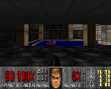

# Doom runs in the emulator

17 October 2026.

We have Doom running on the emulated MiniToo. Shareware E1M1 renders at 160×128,
the joystick moves and turns the player, with buttons for firing and Use.
Moving while firing works too. Sound effects now play through the browser.
It was probably inevitable that we'd end up here.

The image is the game's framebuffer, enlarged from 160×128. The status bar now
fits that width: its original 240-wide widget layout was causing overlapping
numbers and pixels to wrap into later rows.

## What is running

The port uses [next-hack's MG24 Doom engine](https://github.com/next-hack/MG24_Doom_BLE/tree/fc02a55340d1d5b1a5155b12ac049436ef5d4f7a),
compiled for PI32v2 with a small MiniToo runtime. QEMU executes the native
program, including the renderer and game logic. The [browser workbench](workbench.md)
shows its pixels and sends GPIO/ADC input changes to the board model.

It runs on one core with interrupts disabled. The runtime supplies startup,
integer arithmetic, display output, input, audio and read-only SD access. It calls no
stock application or ROM services. The kernel is 275,128 bytes; game data lives
in a separate 8 MiB synthetic SD image containing the converted shareware WAD.

| Control | Action |
| --- | --- |
| Joystick up/down or ↑/↓ | Move forward/backward |
| Joystick left/right or ←/→ | Turn left/right |
| Joystick press or Space | Use |
| Button/key 2 | Forward |
| Button/key 3 | Fire |
| Button/key 4 | Use |
| Button/key 5/6 | Turn left/right |

The joystick is digital. Its separate contacts can be held with one keypad
button, so movement and firing work together. The five keypad buttons share an
ADC input; pressing several of those together is still unsupported.

Click **Enable sound** below the display for gameplay sound effects, with mute
and volume controls. The game mixes up to eight channels into the emulated
DAC at 11025 Hz; the browser plays the samples consumed by that DAC. Music is
still disabled. Slower-than-real-time emulation can cause gaps in playback.

## What we checked

A recorded emulator run checked forward and backward movement, both turning
directions, movement while firing, joystick press and release over 34 observed
game frames. Position, angle, ammunition and input bits were read from guest
memory and checked against the final RAM snapshot. A separate run repeated the
existing keypad checks. Ten host tests pass, including status-bar clipping at
the framebuffer edges.

The audio test checks a pistol waveform against the original WAD samples and
compares the live browser transport with the DAC capture byte for byte. The
recorded run has no DAC underruns. Browser checks confirm non-silent buffers
reach a running AudioContext, and pause and mute stop playback.

A later gameplay session exposed a divide-by-zero when a masked wall narrowed
to one screen column. Both wall-rendering passes now handle that case explicitly.
The reported operands pass a native CPU probe using the production arithmetic
code, and the updated game completes a 571-degree turn without a fault.

That is a useful first playable result. It is still an early prototype.

The physical MiniToo has not run this port. It currently loads as a decoded
kernel in the emulator; it has not gone through the robot's ROM/flash
installation rehearsal. Display startup, usable physical SRAM, boot packaging
and storage timing still need work. The 320 KiB cache has only 548 bytes spare
in this level, so memory is tight. Full-game completion, long sessions, enemy
kills and door-opening behaviour have not been verified by the recorded test.
Music, saving and networking are disabled. Emulator speed does not
establish a physical frame rate.

The port and its build inputs remain in the private research tree while those
pieces are worked through. This public update contains the result and screenshot;
there is no downloadable game, WAD, firmware image or emulator package here.

## Credits

The engine work builds on next-hack's MG24 Doom port and id Software's Doom.
The modified engine and native runtime are GPL-2.0-or-later. Doom's game artwork
and shareware data retain their separate terms; the screenshot is shown to
document this experiment and is outside this repository's MIT licence.
